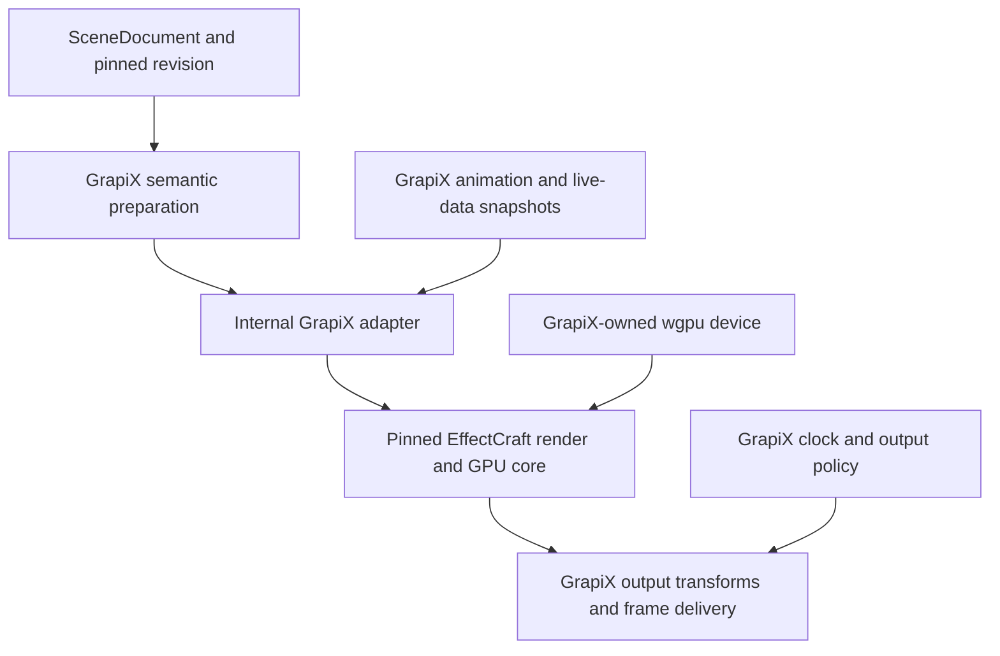

# GrapiX Render Core: EffectCraft Adoption

Date: 11 October 2026. Status: **Planned**, conditional on compatibility
evidence. This ADR records the architecture; `GrapiX-Build-Plan.md` remains the
only implementation plan. Initial investigation is step `3.14`.

## Decision

EffectCraft's `render` and `gpu` crates are the preferred candidate for
GrapiX's compositor. Begin a pinned Windows compatibility spike before
vendoring or changing production rendering. Failure of a required gate can
stop adoption at any stage, including after the initial spike.

**GPU-first requirement (11 October 2026).** GrapiX's main production render
path must run primarily on the GPU. GPU compositing of frames substantially
rendered on the CPU does not by itself satisfy this requirement. The GPU
must own frame drawing/rasterisation, transforms, masks, effects and final
composition. CPU scene semantics, validation, asset decoding, text shaping
and bounded preparation/uploads are allowed; full-scene CPU rendering and
CPU fallback are reference/degraded paths, never the normal live backend.
Cold preparation must occur before a revision becomes take-ready. Live
updates must not reintroduce a CPU full-frame raster/rebuild loop.

Adoption depends on execution evidence for this ownership, not simply an
adapter named GPU or a successful GPU composite pass. If the candidate's
CPU source/mask paths remain a substantial part of per-frame production,
use its GPU effects/resources only with a GrapiX-owned GPU drawing path, or
choose another backend. Adoption of the entire render core is conditional;
the GPU-first requirement takes precedence over the preferred candidate.

GrapiX retains SceneDocument, semantic validation, packaged assets and fonts,
revisioning, animation semantics, publish/cue/take, the Program clock,
Preview/Program delivery, output policy and recovery. An internal adapter
owns all EffectCraft types. Protocol v3 and persisted SceneDocument never
depend on those types.

EffectCraft describes itself as an alpha, clean-room After Effects
reimplementation, with a UI-independent engine and MIT OR Apache-2.0 code.
These are upstream claims, not GrapiX execution evidence. The initial spike
pins commit `9a7d3e76991d5372448033b473dc12c2480a6a04`; all source claims
and measurements must identify their commit. No dependency follows `main`.

## Current worker: what to retain

The current working tree, including uncommitted headless-render work, has a
CPU renderer and useful runtime infrastructure. On 11 October 2026,
`cargo test --locked -p gx-render-worker -p gx-pixel-gate --lib --quiet`
passed 71 worker tests and four pixel-gate tests; the checked-in baseline
comparison also passed. This proves consistency of the existing CPU path,
not complete visual fidelity or GPU rendering.

| Area | Current implementation | Adoption boundary |
|---|---|---|
| Scene preparation | Validation, hierarchy resolution, verified asset binding, lyon tessellation, packaged-font shaping, mesh preparation | Retain semantic preparation; separate it from backend-specific preparation |
| Runtime | Pinned revisions, animation evaluation, publish/cue/take, emission, recovery | Remains GrapiX-owned |
| GPU | wgpu 26 device/queue creation and texture-limit negotiation; no draw pipelines or submission | Adopt rendering; GrapiX creates and owns the shared device |
| CPU reference | Linear-light composition and output encoding; CPU tile planning | Keep for its accurately rendered subset and historical diagnostics |
| Text | cosmic-text shaping; drawing uses advance rectangles | Retain packaged-font authority; replace placeholder drawing |
| Images | Asset validation but no drawing path | Candidate core feature; requires mapping and pixel evidence |
| Gradients | Refused by the current vector backend | Candidate core feature; requires mapping and pixel evidence |
| Meshes | Basic CPU 2D projection | Advanced 3D compatibility is unproven; keep mesh-pass ownership open |
| Scene order | Vectors, then text, then meshes | Adapter must preserve SceneDocument's effective order across types |
| Animated vectors | Per-frame geometry rebuild | Core caching is a candidate optimisation, not a performance guarantee |

`PreparedScene::prepare` currently invokes the CPU rasteriser and refuses
unsupported gradients. It cannot be reused unchanged as the candidate
backend's input. Split semantic validation/asset resolution from lyon,
glyph and mesh backend preparation. New backend capability declarations
must reflect measured support rather than the old fixed-function list.

## Ownership and adapter

Compilation at publish produces an immutable backend project for each pinned
revision. Each render instance holds its own immutable override snapshot
and bounded cache; Preview and Program share a device but do not share
mutable scene state. A take switches a pinned render instance, and recovery
recompiles from the pinned document before outputs are explicitly re-armed.

Map vectors, text and images into one ordered stack. Groups do not
automatically become isolated nested compositions: preserve hierarchy,
effective opacity, transforms, clipping and cross-group order first. Use
parenting or collapsed compositions only where semantic tests prove them
equivalent. Mesh/2D interaction needs its own tested mapping.

The compile report names unsupported objects, properties and material modes
with stable object IDs and document paths. Authoring preview may show an
explicit diagnostic. Publish/live readiness refuses an unsupported mapping
unless an alternate implementation produces equivalent pixels. A visible
placeholder is not a production fallback (invariants 17, 18 and 29).

### Animation and live data

Compile keyframes only after property-specific parity tests establish
equivalent interpolation, easing, rational time conversion, parenting and
phase behaviour. Other properties remain GrapiX-evaluated.

Current-frame value injection is insufficient for Echo, motion blur,
particles or another effect that samples other times. Those paths need
GrapiX evaluation at every requested sample time, proven equivalent compiled
curves, or a named unsupported refusal. Markers carry phase metadata;
GrapiX still executes in/loop/out and continue semantics.

Upstream Essential Properties are precomposition-instance overrides and
currently render from a project copy. They are not assumed to be a generic
zero-copy live-data interface. The spike must establish override isolation,
copy/allocation cost, cache invalidation and text-update latency. No
per-frame project rebuild or pipeline creation is accepted (invariant 35).

### Device, colour and output

The pinned candidate uses wgpu `30.0.1` and Rust `1.95`; GrapiX currently
uses wgpu `26` and declares Rust `1.89`. `Gpu::new(adapter, device, queue)`
supports a host-created device, but those versioned types are incompatible.
The spike uses a separate temporary workspace and explicit toolchain; it
does not upgrade the product workspace. Production adoption requires a
reviewed workspace-wide version/lockfile change and re-verification.

Render internally in premultiplied linear light. Preserve tagged source
conversion and separate sRGB Preview from Rec.709/BT.1886 Program output.
Upstream's sRGB display texture is not automatically suitable for Program.
Verify alpha convention, quantisation, gamut and exactly one output encoding
against GrapiX's colour contract.

GPU frames cross the adapter as GrapiX-owned frame handles. CPU outputs may
use bounded asynchronous readback; GPU-capable outputs may avoid readback.
Frame pacing and drop handling remain GrapiX's. Measure actual CPU fallback
transfers: unsupported GPU effects may introduce intermediate readbacks, so
one final readback is a target, not an upstream guarantee. A blocked output
consumer must never stall the Program clock.

Disable timing-driven automatic CPU/GPU selection for live certification.
Report the actual backend and fallback reason per render path. Define
device-loss, allocation-failure, stale-completion and readback-timeout
behaviour explicitly; degraded CPU operation does not inherit T0 readiness.

Upstream currently renders text, shape sources and masks on the CPU into
its layer cache, then uploads the buffers. Static cached source preparation
can be acceptable outside the frame loop; continuously changing vector,
mask, text or live-data content needs a GPU drawing path and measured CPU
cost. The spike must expose every CPU render/fallback stage and its transfer
cost; a fast cached-solid benchmark alone cannot pass the GPU-first gate.

Large stages must obey GrapiX's tile/overscan and f64-origin invariants 37/38.
The candidate can decline a frame over its texture limit. Existing CPU tile
planning alone does not prove candidate GPU tiling or tile-safe effects.

## Verification and compatibility gates

The initial spike gathers evidence; it does not certify production. Confirm
the show targets, reference GPU/driver matrix, owner and broader time box
before performance acceptance. Initial investigation uses this machine's
RTX 3070 Ti and Windows driver `32.0.15.9159`; it is one sample, not the
certification matrix.

Reference workloads are a lower third, a scorebug with approximately 20 live
text fields and a full-screen stats page, at 1080p50 and 2160p50. Timing must
include semantic evaluation, live updates, CPU layer rendering, upload,
GPU completion and required output readback. Record cold and warm behaviour,
Preview/Program concurrency, frame counts and percentile methodology.

| Gate | Required evidence |
|---|---|
| Windows build/execution | Pinned release build and core tests on DX12 and Vulkan; adapter and driver recorded; skipped GPU tests are not passed |
| GPU-first frame production | Trace scene preparation, rasterisation, masks, effects, composition and output with CPU timings, GPU timestamps and upload/readback counters; animated/live-update workloads use GPU drawing and never silently fall back to full-frame CPU rendering |
| Device sharing | Two render instances on one host-created device, no upstream patches required for construction; measured limits and features recorded |
| Frame budget | Proposed p99 end-to-end render time <=10 ms at 50p for each reference workload; show target still requires confirmation |
| Live updates | Proposed first affected Program frame within one frame period after an accepted update; no cross-instance mutation or stale-cache output |
| Output/readback | Actual output-format conversion and bounded readback fit the 20 ms period at both sizes; no consumer-induced clock stall |
| Colour/alpha | Linear internal pipeline, tagged sources, sRGB Preview, Rec.709/BT.1886 Program and correct transparent edges |
| Text/fonts | Only packaged font bytes; missing faces refuse; shaping parity including Telugu, Hindi, bidi and fallback; real glyph pixels checked |
| Semantic mapping | Mixed object order, groups/opacity, transforms, clips, material modes, mesh interaction and unsupported-property refusals |
| Temporal sampling | Compiled-curve parity and GrapiX evaluation at off-frame times; Echo/motion blur and phase transitions tested |
| Accurate existing subset | Old baselines retained for regression where rendering is correct; known placeholder/omission bugs get reviewed replacement expectations |
| Core CPU/GPU agreement | Pinned upstream oracle rerun; tolerances, relative/HDR rules and allowed boundary exceptions reported per test |
| Tiles and precision | Above-limit stage, distant origin, tile seams and effect footprints; no whole-stage texture or silent CPU fallback |
| Failure/lifecycle | Device loss, allocation/readback failure, revision swaps, cache bounds and output-inhibited recovery |
| Soak | Eight hours with periodic takes/updates; bounded memory/cache growth and no drops attributable to the core |
| Bounded dependency integration | Exact transitive closure, licence/SBOM review and a small documented patch set |

There are three separate comparisons: GrapiX's accurate CPU subset against
the adapter; upstream CPU against upstream GPU; and GrapiX animation against
compiled curves. None is ground truth for every feature. Existing baselines
cannot require the new renderer to keep rectangle text, omitted images or
incorrect mixed ordering. Preserve those historical images and document
each reviewed correction separately.

Upstream's headline GPU tolerances are <=1/255 at 8 bpc and <=1e-3 at 32 bpc,
but its tests also document quantisation-boundary and discontinuous-mode
exceptions, with relative handling of over-range float values. GrapiX must
record the actual assertion policy rather than adopting the headline alone.
Compile-report expectations are versioned; a new unsupported mapping fails
the gate. No-adapter or fallback-only execution is recorded as SKIP or a
named limitation, never GPU PASS.

## Vendoring and rollout conditions

After passing the gates, vendor only the dependency closure of `render` and
`gpu`, with the upstream commit, lockfile provenance, licences, NOTICE and
required asset attributions. Review transitive dependencies as well as these
two crate licences. UI, app, CLI, host/session and automation crates are
outside the product closure unless separately justified. PhotoCraft PSD
import remains an independent decision.

Deliberate pinned updates rerun verification. Record every patch; upstream
contributions require separate authorization to publish. Forks must respect
the upstream brand restrictions. No upstream messaging or publishing is
part of this spike.

Preview cutover requires GPU-first, semantic/colour evidence and explicit backend
status. Program cutover additionally requires confirmed performance targets,
output testing, failure handling and the soak. Keep the current output path
available until those pass. Any failed gate can halt or reverse a cutover.

Open decisions: font shaping authority; vector backend; mesh ownership;
certification GPUs/drivers; confirmed performance targets; spike owner and
time box. These are evidence/acceptance questions, not reasons to stop the
authorized initial isolated investigation.

## Initial spike findings

The pinned `render`/`gpu` Windows release build succeeded using the separate
Rust 1.95 toolchain. Shared host-device rendering and separate static project
pixels passed on Vulkan and on DX12 with explicit DXC `1.8.2502.11`, with
CPU/GPU maximum channel delta approximately `6e-8`. No tracked upstream
source was patched; the probe was compiled as an added example.

| Executed gate subset | Result on this RTX 3070 Ti |
|---|---|
| Default DX12 initialization | **FAIL**: Auto fell back to FXC; `classic3d` failed D3DCompile loop unrolling |
| DX12 with explicit DXC, static shared-device probe | **PASS** for the probe's scope |
| DX12 with DXC, full GPU crate tests | **FAIL**: 147 passed, 56 failed, 1 ignored; includes Bpc32 NaNs and large effect mismatches |
| Vulkan, full GPU crate tests | **PASS** for this suite: 203 passed, 0 failed, 1 ignored; real hardware adapter reported |
| CPU render crate tests | **PASS**: 201 passed, 0 failed, 1 ignored |
| GPU-first animated/live-update drawing | **Not verified**; upstream still draws base text/shapes/masks on CPU |
| Font isolation and complete SceneDocument semantics | **Not verified**; named integration gaps remain |
| Reference shows, actual outputs, tiles, failure recovery, eight-hour soak | **Not run** |

At the default 1 GiB CPU layer-cache budget, a synthetic two-solid scene
through the display-texture API and final RGBA8 readback measured:

| Backend | 1080p p50 / p99 | 2160p p50 / p99 |
|---|---|---|
| DX12 + DXC | 6.595 / 7.769 ms | 32.130 / 35.545 ms |
| Vulkan | 5.837 / 6.837 ms | 26.433 / 28.825 ms |

Each row uses five warmups and 30 samples; p99 is nearest-rank and therefore
the maximum of this small sample. Timings include the upstream display
texture's mipmap generation and synchronous readback, not an implemented
Program/NDI path. Both 4K paths exceed a 50p frame's 20 ms period even on this
simple workload. This is a named performance limitation of the probed path,
not certification evidence or a claim that every possible GPU output fails.

At 256 MiB, a full 4K float layer exceeds the cache's per-entry limit
(`budget / 4`). The 35 rendered frames made 36 uploads rather than two and
were much slower. Cache counters and the final probe source hash are in
`memory.md`; the experiment includes both budgets so this remains visible.

**Recommendation:** do not vendor or cut over production to this pin yet.
Vulkan makes the GPU core worth investigating, but the full render-core
adoption has not met the GPU-first requirement. Compare the cost of GPU
layer drawing integration with a GrapiX-owned GPU drawing/composition path
using selected upstream effects. Fix or explicitly scope the DX12 failures,
prove packaged-font isolation and reduce Program output cost before further
cutover work. Detailed execution evidence is in `memory.md`; step `3.14`
remains active, with no adoption gate represented as complete.

The Windows normal dependency tree has 134 distinct package/version entries,
including 14 EffectCraft crates; the closure includes `segment` and `track`
through `effects`. There are no UI/app crates in this inspected normal
closure. This is an inventory, not a completed licence audit: in particular
the `Unicode-3.0` conjunct needs reconciliation with GrapiX's current accepted
licence list. Build/dev/platform closures and embedded assets still require
review before vendoring.

Font isolation is a concrete integration gap. The pinned text engine keeps
a process-global database, starts with bundled fonts, registers in-memory
fonts and can scan system fonts when resolution misses. Unknown families
fall back to Inter. Registering packaged font bytes alone therefore does
not satisfy GrapiX's no-substitution contract or per-revision font isolation.
This needs an isolated-font API or GrapiX-owned glyph input, followed by
execution evidence; it is not covered by a successful compositor probe.

## Sources

- [Pinned EffectCraft architecture](https://github.com/storytold/effectcraft/blob/9a7d3e76991d5372448033b473dc12c2480a6a04/docs/architecture.md)
- [Pinned workspace versions](https://github.com/storytold/effectcraft/blob/9a7d3e76991d5372448033b473dc12c2480a6a04/Cargo.toml)
- [Pinned GPU API](https://github.com/storytold/effectcraft/blob/9a7d3e76991d5372448033b473dc12c2480a6a04/crates/gpu/src/lib.rs)
- [Pinned GPU oracle and exceptions](https://github.com/storytold/effectcraft/blob/9a7d3e76991d5372448033b473dc12c2480a6a04/crates/gpu/src/tests.rs)
- [GrapiX invariants](../invariants.md), [colour/output contract](0002-platform-and-mcp-schema.md)
- GrapiX worker: `prepared.rs`, `gpu.rs`, `text.rs`, `mesh.rs`, `rasterise/lyon.rs` in the working tree reviewed on 11 October 2026.
