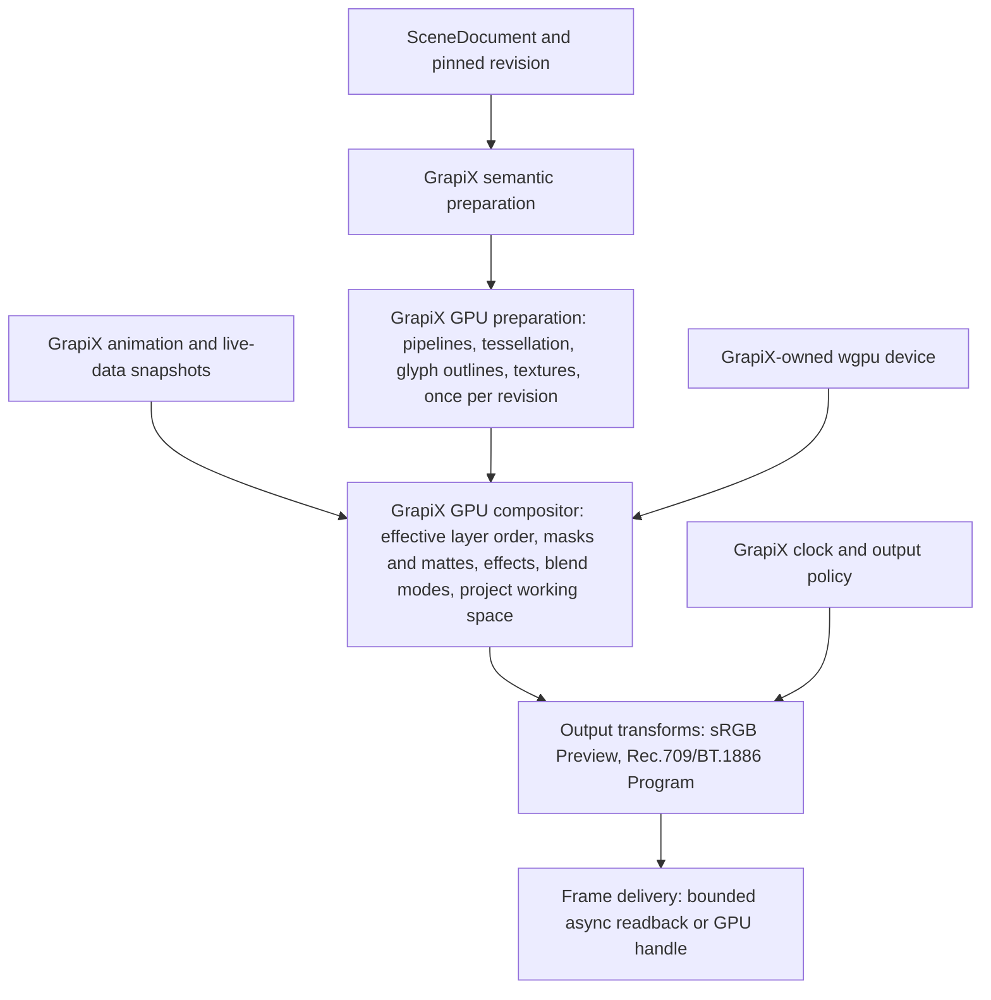

# GrapiX Render Core: GPU-first compositor, EffectCraft as component source

Date: 11 October 2026; decided 12 October 2026. Status: **Accepted** as
architecture. The compositor itself is **Planned** (build-plan steps
`3.15`–`3.22`, `11.60`–`11.62`). This ADR records the architecture and its
rationale; `GrapiX-Build-Plan.md` remains the only implementation plan.

## Decision (user, 12 October 2026)

1. **GPU-first, GrapiX-owned compositor.** The main render path runs on the
   GPU: frame drawing and rasterisation, transforms, masks, effects and final
   composition. CPU work is limited to scene semantics, validation, asset
   decoding, text shaping and bounded preparation and uploads. Full-scene CPU
   rendering is a reference and test path, never the live backend and never a
   silent fallback. Cold preparation completes before a revision is
   take-ready, and nothing that can be built once is built per frame
   (invariant 35).
2. **Whole-core adoption of EffectCraft's `render` and `gpu` crates is
   halted.** The `3.14` spike failed required gates by execution and by
   design (below). The core is not vendored and is not a product dependency.
3. **EffectCraft is the preferred component source.** Its algorithms, WGSL
   kernels, importers and tests are ported into GrapiX-owned code, with
   attribution, under the build-plan step that owns each piece (reuse
   catalogue below). Its CPU renderer may serve as a dev-only test oracle
   outside the product closure.
4. **Colour follows the project.** Compositing happens in the project's
   declared working colour space, not unconditionally in linear light. This
   amends ADR-0002 B.1 (see "Colour" below; step `3.15`).
5. **Ownership is unchanged from 11 October.** GrapiX owns SceneDocument,
   semantic validation, packaged assets and fonts, revisioning, animation
   semantics, publish/cue/take, the Program clock, Preview/Program delivery,
   output policy and recovery. Protocol v3 and persisted SceneDocument never
   depend on third-party renderer types.

## Why whole-core adoption stopped

EffectCraft (`storytold/effectcraft`, MIT OR Apache-2.0) is an alpha,
clean-room After Effects reimplementation in Rust. Evidence is from the pinned
commit `9a7d3e76991d5372448033b473dc12c2480a6a04` on this machine's
RTX 3070 Ti (DX12 driver `32.0.15.9159`); logs are cited in `memory.md`.

| Required gate | Evidence | Result |
|---|---|---|
| Windows DX12 execution | Default initialisation (FXC): `classic3d` fails D3DCompile loop unrolling (11 Oct). With DXC 1.8.2502.11 the upstream GPU suite gave 147 passed / 56 failed (11 Oct) and 153 passed / 50 failed (12 Oct rerun). The failing set differs between runs, and 32-bit blend modes emit NaN (Darken on 11 Oct, ClassicDifference on 12 Oct) | **FAIL**, and not deterministic |
| Vulkan execution | Upstream GPU suite 203 passed / 0 failed / 1 ignored (11 Oct) | PASS for that suite |
| Frame budget, 2160p50 | Two static solids through upstream's display texture and readback: p99 35.5 ms DX12 and 28.8 ms Vulkan (11 Oct); 57.5 ms DX12 (12 Oct), against a 20 ms period | **FAIL** |
| GPU-first frame production | Upstream draws text, shape and mask sources on the CPU into its layer cache and uploads them; an unsupported GPU step reads back to the CPU, and an unsupported frame declines to the CPU path (`crates/gpu/src/lib.rs`, `crates/gpu/src/walk.rs`, `crates/render/src/lib.rs`) | **FAIL by design** |
| Font isolation | Process-global font database, system-font scanning, an unknown family substituted with Inter (`crates/text/src/fonts.rs`) | FAIL (source) |
| Refusal semantics | "Return `None`, let the CPU render"; unknown effect ids skipped; missing effect parameters read as 0, white or false | Conflicts with invariants 17 and 18 |
| Bounded dependencies | 134 packages in the `gpu` normal closure, including ML segmentation and camera tracking through `effects`; requires Rust 1.95, edition 2024 and wgpu 30 workspace-wide | Not small |
| Upstream stability | First commit 1 October 2026; 1,584 commits by 12 October, 279 of them in the two days after the pin | A pinned core would need every gate rerun on each update |

The shared host-device probe passed on both backends within its scope
(CPU/GPU delta about `6e-8`), so upstream's GPU kernels are a sound source
for porting. They are not a production core.

## Architecture

Rules for the compositor:

- **Ordering.** Vectors, text, images and meshes composite in SceneDocument's
  effective order across object types. Groups preserve hierarchy, effective
  opacity, transforms and clipping; isolating a group as a nested composition
  is used only where semantic tests prove it equivalent.
- **Working textures** are premultiplied, in the project working space. Their
  precision is chosen and measured in `3.16` and `3.21`; upstream's 32-bit
  float working textures (about 133 MB per 2160p frame) are a measured 4K
  cost, not a default to copy.
- **Refusals.** An unsupported object, property, effect, mode or combination
  refuses by stable object id and document path, and a compile report lists
  them. Authoring preview may show an explicit diagnostic; publish and take
  readiness refuse. A placeholder is never a production fallback (invariants
  17, 18 and 29). The backend in use and any refusal are reported per render
  path.
- **Text.** cosmic-text shapes package-owned font bytes only (`3.6`); glyph
  outlines are drawn on the GPU (`3.18`). EffectCraft's text engine is not
  used.
- **Tiles.** Large stages obey invariants 37 and 38; tile-safe effects declare
  their footprint.
- **3D.** Shading is computed in linear light inside the 3D pass and enters
  the composite in the project working space.
- **Device and toolchain.** GrapiX creates and owns the device. The product
  stays on its pinned wgpu and Rust until a separate reviewed upgrade (for
  example if `3.17` selects Vello, which needs a newer wgpu). Ported code is
  rewritten for the workspace's edition and toolchain.
- **Live updates and temporal effects.** Effects that sample other times
  (echo, motion blur, particles) receive GrapiX-evaluated values at every
  sample time, or refuse by name. A live update reaches the first affected
  Program frame without a per-frame rebuild.
- **Failure.** Device loss, allocation failure, stale completions and readback
  timeouts are defined explicitly. A degraded CPU path never inherits T0
  readiness, and a blocked output consumer never stalls the Program clock.

## Colour: the project working space

The project declares its working colour space, and every scene in it
composites in that space: blending, alpha compositing, gradient
interpolation, filtering and effects. Tagged sources convert into it once
(never inferred); the sRGB Preview and Rec.709/BT.1886 Program transforms
apply once on the way out. A scene whose declared space differs from its
project's refuses by name.

Figma, Photoshop and After Effects (by default) composite gamma-encoded
values. Compositing those designs in linear light changes every
semi-transparent overlap, anti-aliased edge, gradient and shadow, so `18.8`
(Figma fidelity within the pixel gate) could not pass under ADR-0002's former
"linear, always". A project that wants physically linear compositing declares
linear sRGB. **New projects default to sRGB** so imported designs reproduce;
the owner may change that default. The contract change (`WorkingColorSpace`
gaining variants, and its "composite in linear, always" documentation) is
made in `3.15`.

## Plan mapping and acceptance gates

| Step | Owns | Gates carried from the 11 October ADR |
|---|---|---|
| `3.15` | Project working colour space | Colour and alpha; colour ramp on both platforms |
| `3.16` | GPU compositor core | GPU-first trace; semantic mapping and order; tiles and precision; Preview and Program instances sharing one device |
| `3.17` | GPU 2D drawing (lyon-on-GPU and Vello measured) | CPU/GPU agreement under a recorded assertion policy |
| `3.18` | GPU text from packaged fonts | Packaged bytes only; missing glyph refuses; Telugu, Hindi and bidi pixels |
| `3.19` | Masks, clips, mattes, trim paths | Silent trim omission removed |
| `3.20` | Full blend-mode set | No NaN or infinity reaches output, in either working space |
| `3.21` | Output, readback, frame budget | p99 ≤ 10 ms at 50p for the reference workloads at 1080p and 2160p; output and readback within the period; no consumer-induced clock stall |
| `3.22` | Typed effect registry, broadcast set | DX12 and Vulkan agreement per effect |
| `11.60`–`11.62` | Layer styles, text animators, effect and style controls | Photoshop reference renders; deterministic per-glyph animation |

Reference workloads are a lower third, a scorebug with about 20 live text
fields and a full-screen stats page, at 1080p50 and 2160p50, timed end to end
(evaluation, live updates, drawing, GPU completion, output readback), cold
and warm, with Preview and Program running concurrently. Failure and
lifecycle behaviour and an eight-hour soak gate the Program cutover. No
skipped or no-adapter GPU execution counts as PASS. Certification GPUs and
drivers, and confirmed show targets, are still to be named.

## Current worker: what to retain

| Area | Today | Under this ADR |
|---|---|---|
| Scene preparation | Validation, hierarchy, verified asset binding, lyon tessellation, packaged-font shaping, mesh preparation | Split semantic preparation from GPU preparation; `PreparedScene::prepare` cannot feed the GPU path unchanged |
| Runtime | Pinned revisions, animation evaluation, publish/cue/take, emission, recovery | Unchanged |
| GPU | wgpu 26 device and texture-limit negotiation; no draw pipelines | `3.16`–`3.22` |
| CPU reference | Linear composition, output encoding, tile planning | Kept for its accurately rendered subset and diagnostics; old baselines are not expectations for placeholder output |
| Text | cosmic-text shaping; advance rectangles drawn | `3.18` |
| Images and gradients | No drawing path; gradients refused | `3.17` |
| Meshes | Basic CPU projection; glTF geometry empty (the `3.7` defect) | `11.48`, `16.6`–`16.8` |

> **7 November 2026:** the GPU row describes the worker when this ADR was
> written. By the user's decision its wgpu moved from 26 to 30.0.1 (`0.2`);
> negotiation, tiers and the CPU-adapter refusal are unchanged, and it still
> has no draw pipelines.

## EffectCraft reuse catalogue

Reference clone: `agent/reference/effectcraft` at the pinned commit, never
built into the product. Upstream has moved on (0.9.0 on 12 October); each
port cites the commit it was taken from.

**Obligations.** MIT OR Apache-2.0: keep "Copyright (c) 2026 ArtCraft Team and
the EffectCraft contributors" and the licence text in GrapiX's third-party
notices, and cite the source file in each ported file. Never take the ArtCraft
name, wordmark, logos or app icons (`docs/brand/`), or the bundled OFL fonts.
Every port strips silent fallbacks, guards slice indexing, removes float time
and rate constructors and rewrites edition-2024 syntax.

Verdicts: **COPY** near-verbatim; **PORT** the algorithm into GrapiX types;
**LEARN** design only. Paths are under upstream `crates/` unless noted.

| Upstream | Lines | Verdict | Step |
|---|---|---|---|
| `gpu/src/shaders/common.wgsl`: blend modes, `imod`, `asin_p`, `powz`, `round_away`, `hash_noise` | 541 | COPY | 3.16, 3.20, 4.5 |
| `gpu/src/shaders/kernels.wgsl`: compositing, box and Gaussian blur passes, glow, drop shadow | 1,016 | PORT | 3.16, 3.22 |
| `gpu/src/shaders/fx_*.wgsl`: 280 GPU effects in 20 families | 11,720 | PORT on demand, broadcast subset first | 3.22 |
| `color/src/blend.rs`: 38 modes, CPU reference | 538 | PORT | 3.20 |
| `render/src/styles.rs`, `project/src/styles.rs`, `render/src/tests_styles.rs`: layer styles (distance-field spread and choke, glows, bevel height field) | 765 + 485 + 477 | PORT to GPU | 11.60 |
| `engine/src/psd_import.rs` blend and style tables (L25–89, L505–686) | ~250 | PORT; every silent drop becomes a named finding | 11.59, 11.60 |
| `effects/src/util.rs`, `misc.rs`, `color_fx.rs`, `color2.rs`, `generate.rs`, `noise3.rs`, `transition.rs` | ~6,300 | PORT as CPU references for the ported kernels | 3.22 |
| `effects/src/lib.rs` registry-wide tests (L1212–1406) | ~200 | LEARN; redo on the typed registry | 3.22 |
| `script/src/matchnames.rs`: After Effects effect match names | 461 | COPY as data | 11.59 |
| `render/src/three_d/adv/shade.rs`, `raster.rs`, parts of `scene.rs` | 410 + 492 + parts | PORT | 11.48, 11.50, 16.6–16.8 |
| `model/src/extrude.rs`, `triangulate.rs` | 317 + 187 | COPY | 11.48 |
| `model/src/prim.rs` (per-face parts) | 235 | PORT | 11.48 |
| `gpu/src/tests.rs` diff and check harness (L193–252), `tests_adv3d.rs` | ~600 | PORT the pattern; a missing adapter fails | 3.16, 4.5, 13.6 |
| `render/src/cache.rs`, `gpu/src/walk.rs`, `context.rs`, `readback.rs` | ~2,900 | LEARN | 3.16, 3.21, 15.11 |
| `path/src/ops.rs`, `boolean.rs`, `offset.rs`, `fit.rs` and tests | 1,720 | COPY; needs kurbo and linesweeper (a dependency decision) | 3.19, 11.47, 18.4 |
| `path/src/interp.rs` | 519 | PORT, adding tangent-length checks | 11.47 |
| `text/src/selectors.rs` and tests | 396 | COPY | 11.61 |
| `render/src/text.rs` animator application (L163–391) | ~230 | PORT | 11.61 |
| `text/src/fonts.rs` glyph-coverage check (L709–754) | 46 | PORT | 11.42, 11.51 |
| `svg/src/pathdata.rs`, `svg/src/color.rs` | ~500 | COPY | 7.2, 18.2, 18.4 |
| `keyframe/src/lib.rs` ease solver (L166–226), spatial segments (L242–366) and After Effects-measured tests; `docs/fidelity/keyframe-ease.json` | ~300 | PORT; Rust authority first, then regenerated TS | 11.11, 11.23, 11.59 |
| `time/src/lib.rs` drop-frame timecode (L160–474) and property tests | ~300 | PORT; not `Tick`, not the float constructors | Playout timecode, 11.59 |
| `geom/src/lib.rs` 3D layer transform, inverse, `look_at`, `square_to_quad` | ~200 | PORT | 11.44, 11.48 |
| `color/src/icc.rs` (`parse`, `Trc`, `is_srgb`; L22–230) | ~210 | PORT | 3.15, 11.52, 11.59, 18.2 |
| `color/src/space.rs` `rgb_to_xyz` and `bradford` (L253–276), but not its pure-2.4 "Rec.709" | ~25 | PORT | 3.15 |
| `psd/` (depends only on `miniz_oxide`, already in the lockfile) | 3,232 | COPY, then extend: `lmfx`, Blend If, shape fill and stroke, artboards, a separate mask accessor, a lower pixel cap | 11.59, 11.60, 7.3 |
| `pdf/` (PDF-compatible `.ai` only; its font fallback becomes a refusal) | ~8,000 | PORT | 11.59 |
| `lottie/` import (`import.rs` L315–465, `shapes.rs`, `anim.rs`) and its 4 test fixtures | ~1,000 | PORT; COPY the fixtures | 16.5 |
| `expr/src/noise.rs` (wiggle, noise, random) | 109 | COPY as host functions | 16.4, 11.55 |
| `expr/src/prelude.js` maths, easing and loops | ~600 of 1,037 | PORT to the rquickjs sandbox | 16.4, 11.56 |
| `automation/` frame-to-PNG MCP image tool; `server.rs` and `tools.rs` conventions, `long_job.rs`, `guard.rs` | ~1,500 | COPY and PORT | 8.1 and 8.9 re-verification, 8.14, 11.41 |
| `engine/src/history.rs` merge keys and dirty-follows-undo; save with read-back check | ~400 | LEARN | 11.37 follow-up, 11.43, 11.46 |
| `media/src/convert.rs` (YUV to RGB, ranges, alpha) | 514 | PORT to GPU | 11.49, 16.1 |
| `segment/src/lib.rs` model registry (licence, URL, size, SHA-256) | 272 | PORT, with `sha2` | 16.10, 16.11 |
| `ui-egui` graph and timeline maths: speed curves, handle-drag ease, pixel-tolerance snapping, viewer `snap()` and handle maths, scrub fields | ~800 | PORT to TypeScript | 11.11, 11.22, 11.23, 11.44, 11.46 |
| `xtask/src/main.rs` (repository root) `layers()` via `cargo metadata`, `assets()` attribution check | ~150 | PORT | 0.4, boundaries gate |
| `packaging/windows/sign.ps1`, `test-msi.ps1` (repository root); macOS verify and staple steps | ~400 | COPY and PORT | 11.1 |
| `docs/ui-parity.md` format (repository root) | 47 | COPY the format | 11.24 |

**Skip:** the encoders (`vp9enc`, `av1enc`, `hevcenc`, `opusenc`, `export`),
motion and camera tracking and ML inference, the egui UI, CLI, host and
ExtendScript layers, EPS, the film-VFX effects, upstream's media pool, and the
bundled fonts and brand assets. FilmCraft's pure-Rust decoders (ProRes, DNx)
are a candidate for `16.1` only through a written P.2 position that excludes
`filmcraft-codecs` (MPL-2.0 Symphonia) and every encoder.

## Open decisions

- The new-project default working space (recorded here as sRGB).
- The 2D drawing backend, measured in `3.17` (Vello implies a wgpu upgrade).
- kurbo and linesweeper for the path operators, under the dependency policy,
  when `3.19` or `11.47` starts.
- The certification GPU/driver matrix and confirmed show performance targets.
- FilmCraft decoders for `16.1` (P.2).

## Sources

- [Pinned EffectCraft architecture](https://github.com/storytold/effectcraft/blob/9a7d3e76991d5372448033b473dc12c2480a6a04/docs/architecture.md)
- [Pinned workspace versions](https://github.com/storytold/effectcraft/blob/9a7d3e76991d5372448033b473dc12c2480a6a04/Cargo.toml)
- [Pinned GPU API](https://github.com/storytold/effectcraft/blob/9a7d3e76991d5372448033b473dc12c2480a6a04/crates/gpu/src/lib.rs)
- [Pinned GPU oracle and exceptions](https://github.com/storytold/effectcraft/blob/9a7d3e76991d5372448033b473dc12c2480a6a04/crates/gpu/src/tests.rs)
- Spike runner `tools/effectcraft-spike/`; evidence and logs in `memory.md`
  (11 and 12 October 2026).
- [GrapiX invariants](../invariants.md), [colour/output contract](0002-platform-and-mcp-schema.md)
